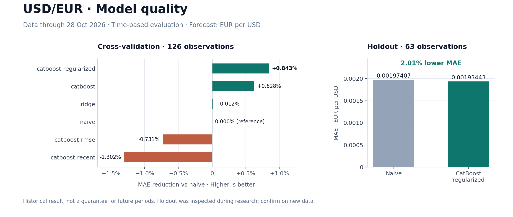
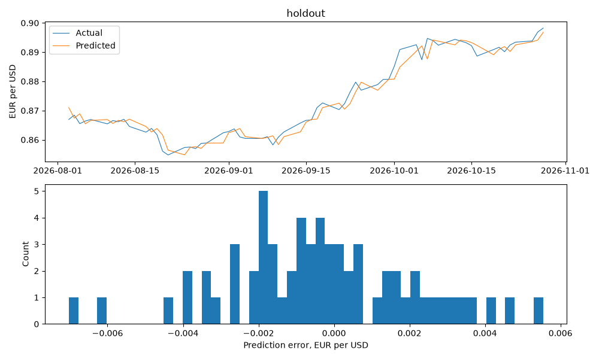
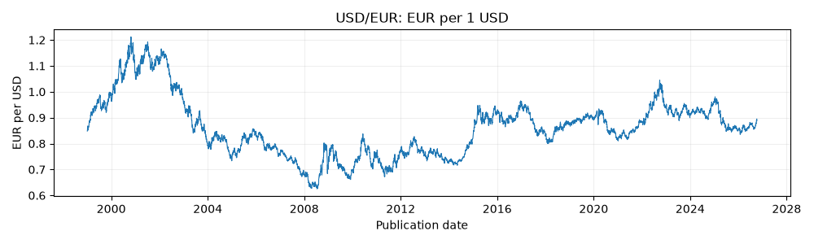
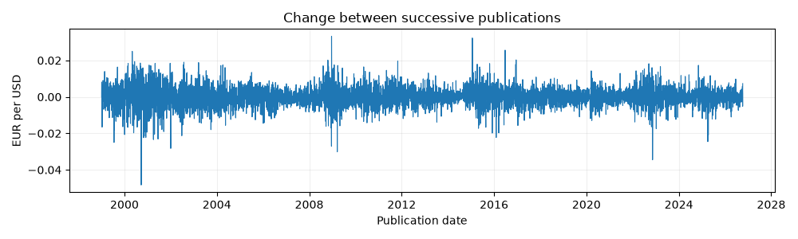
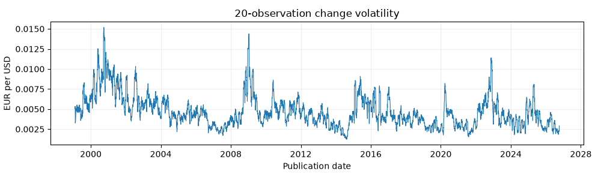
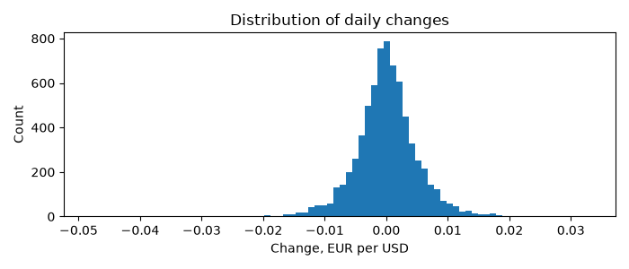
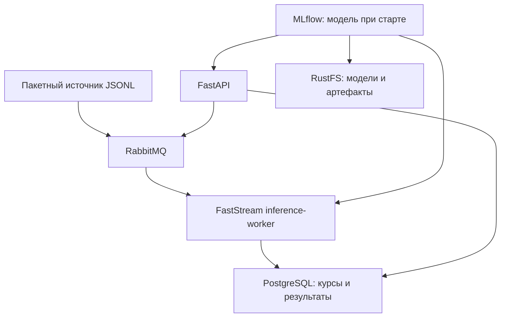
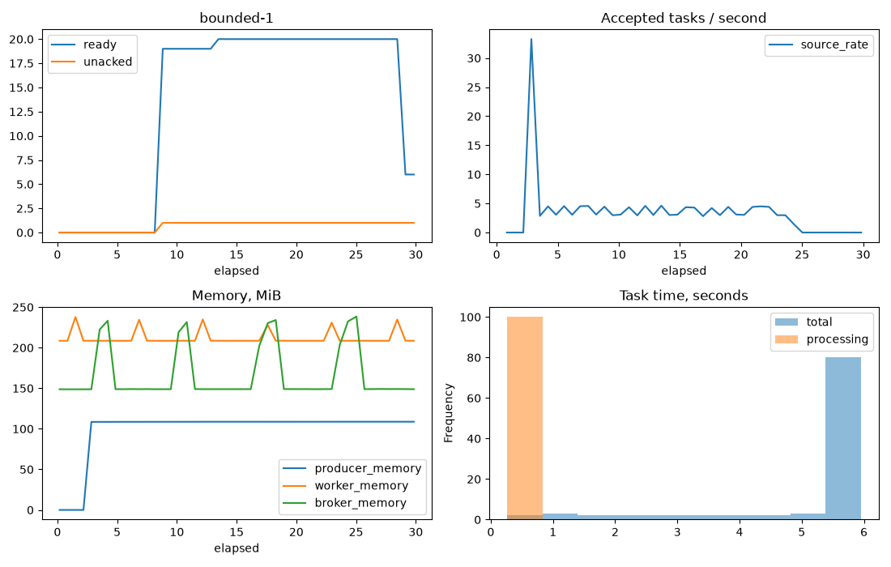
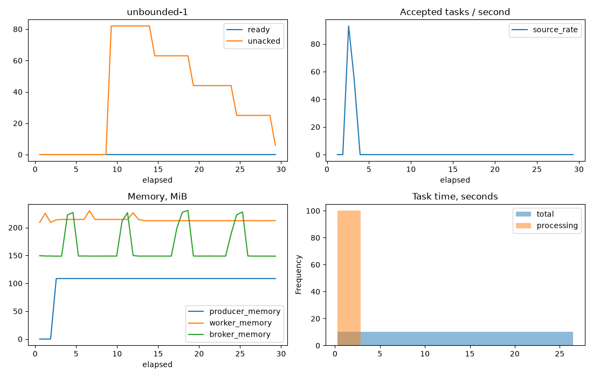

# fx-predictor-ai

Сервис прогнозирования ежедневного курса **USD/EUR - сколько евро стоит один доллар**.
Собираем официальные курсы Европейского центрального банка, сравниваем модели
на исторических данных и выдаём прогноз на следующую публикацию.

Сейчас сервис доступен через HTTP API и Swagger. Курсы нескольких валют можно
посмотреть, прогноз поддерживает одну пару - USD/EUR. Пользовательский сайт,
другие пары и признаки из новостей - следующие этапы.

**Стек:** Python 3.12 · FastAPI · CatBoost · MLflow · PostgreSQL · RustFS ·
RabbitMQ · FastStream · OpenTelemetry · Grafana · Docker Compose · uv · Ruff · pytest · GitHub Actions.

Авторы: **Volkov Vladimir** - [@The_Valdemare](https://t.me/The_Valdemare),
**Vagin Arseniy** - [@quitepeaky](https://t.me/quitepeaky).

## Что уже работает

- Последние опубликованные курсы относительно USD, дата и проверка свежести.
- Прогноз по истории: сервис сам получает данные и рассчитывает признаки.
- Фоновые задачи с получением результата по `task_id`.
- Обновление курсов отдельным процессом.
- Эксперименты, версии данных и моделей в MLflow; явный выбор рабочей модели.
- Ограничение накопления задач, повторы и сохранение результатов в PostgreSQL.
- Поиск истории задачи по логам и трейсам, живой дашборд очереди и алерты.

## Результаты

В сохранённом эксперименте на данных до **28 октября 2026 года**
`catboost-regularized` снизил MAE относительно прогноза «следующий курс равен последнему»
на **0,84% по временной кросс-валидации** и на **2,01% на holdout**.
Это небольшое улучшение на конкретном периоде; его ещё нужно подтвердить на новых данных.

В каждом из двух сохранённых нагрузочных прогонов завершились все 100 задач.
С ограничениями Ready не превышал 20, а Unacked - одного сообщения.
Это подтверждает управление накоплением работы, но не означает ускорение самой модели.

[Запуск](#запуск) · [API](#api) · [Данные](#данные-и-прогноз) ·
[Модели и метрики](#модели-и-качество) · [Архитектура](#архитектура) ·
[Нагрузочные результаты](#очередь-и-нагрузка) · [Разработка](#разработка-и-проверки) ·
[Наблюдаемость](#наблюдаемость) · [Безопасность](#безопасность)

## Запуск

Нужны Python 3.12, [uv](https://docs.astral.sh/uv/), Git, Make и Docker с Compose **2.20+**.
Команды выполняются из корня проекта. На Windows подойдёт PowerShell с Make
или WSL2; Docker Desktop должен быть запущен.

### Первый запуск

```bash
git clone https://github.com/Vladimir-119/fx-predictor-ai.git
cd fx-predictor-ai
cp .env.example .env
```

В PowerShell вместо `cp` можно использовать `Copy-Item .env.example .env`.
Если `.env` уже существует, сохрани его.

В локальном `.env` замени:

- `POSTGRES_PASSWORD` и тот же пароль в `DATABASE_URL`;
- `RABBITMQ_PASSWORD` и тот же пароль в `RABBITMQ_URL`;
- `RUSTFS_SECRET_KEY`;
- `GRAFANA_PASSWORD`, если будешь включать наблюдаемость.

Для первого запуска проще использовать латинские буквы и цифры.
Специальные символы в URL требуют кодирования. `.env` исключён из Git.

```bash
make install
make infra
make dataset
make eda
make train
```

`make infra` запускает PostgreSQL, RustFS и MLflow.
`make train` обновляет данные, сравнивает модели и назначает alias `candidate`.
Открой <http://localhost:5001> → последний `training-batch` и проверь результаты.

Номер финальной модели находится в `reports/training.json` → `candidate_version`.
После проверки выполни `make promote VERSION=...`, подставив этот номер.
В PowerShell его можно взять из отчёта:

```powershell
$modelVersion = (Get-Content reports/training.json -Raw | ConvertFrom-Json).candidate_version
make promote VERSION=$modelVersion
```

Теперь запускаем обработку запросов и обновление курсов:

```bash
make tasks
make worker
make update-rates
```

### Повторный запуск

Если модель уже обучена и `champion` назначен:

```bash
make tasks
make worker
make update-rates
```

`make tasks` включает API, inference-worker и зависимости.
`make worker` запускает отдельный процесс обновления курсов.
`make up` запускает основные сервисы, но не включает оба фоновых worker.

| Адрес по умолчанию | Что открыть |
|---|---|
| <http://localhost:8000/docs> | Swagger |
| <http://localhost:5001> | MLflow |
| <http://localhost:15672> | RabbitMQ Management UI |
| <http://localhost:9001> | Консоль RustFS |
| `127.0.0.1:5672` | AMQP-подключение к RabbitMQ |
| `127.0.0.1:9000` | S3 API RustFS |
| `127.0.0.1:5433` | PostgreSQL |

`make down` останавливает стек, сохраняя Docker volumes с данными.
`docker compose down -v` удаляет тома вместе с курсами, моделями и историей MLflow.
Повторно обучать модель после обычной остановки не нужно.

Для подписанных ссылок MLflow использует `http://rustfs.localhost:9000`.
В Chrome/Edge это локальный адрес компьютера, а внутри Compose - сетевое имя RustFS.
`RUSTFS_PORT` задаёт одинаковый S3-порт внутри контейнера и на компьютере.

## API

В Swagger открой `POST /api/v1/tasks` и передай:

```json
{
  "pair": "USD/EUR"
}
```

Ответ `202 Accepted` содержит `task_id`. Подставь его в `GET /api/v1/tasks/{task_id}`.
Задача проходит состояния `QUEUED` → `RUNNING` → `COMPLETED`; при окончательной ошибке -
`FAILED`. В `result` находятся даты, последний курс, прогноз и версия модели.

История по умолчанию берётся из PostgreSQL. Для пакетного исторического пересчёта
можно передать `history` из 20–60 наблюдений.
Для надёжного повтора после сетевого сбоя передавай постоянный `task_id`:
тот же ID и вход не создают новую задачу, тот же ID с другим входом даёт `409`.

| Метод и путь | Назначение |
|---|---|
| `GET /api/v1/rates` | Опубликованные курсы, дата и признак `stale` |
| `POST /api/v1/tasks` | Принять фоновую задачу |
| `GET /api/v1/tasks/{task_id}` | Получить состояние, результат или ошибку |
| `POST /process` | Получить прогноз в том же HTTP-ответе; сохранён для совместимости |
| `GET /api/v1/model` | Модель в памяти API-процесса |
| `GET /healthz` | Проверка живости без обращений к зависимостям |
| `GET /api/v1/health` | Состояние приложения и PostgreSQL, версии и время проверки |
| `GET /api/v1/version` | Версия установленного приложения |

Версию модели фоновой задачи смотри в `result.model.version`.
API и worker загружают модели независимо, поэтому `/api/v1/model` не заменяет эту проверку.

`/process` в текущем коде помечен `deprecated`: Swagger показывает его зачёркнутым,
но маршрут работает. Неподдерживаемые пара или дата дают `422`.
Прямой прогноз при отсутствии модели, свежей истории или доступной БД возвращает `503`;
ошибки фоновой обработки отражаются в задаче. При перегрузке API задач отвечает `503`
с заголовком `Retry-After`.

## Данные и прогноз

Используем `ecb.csv` из
[версии 131 AllRatesToday на Kaggle](https://www.kaggle.com/datasets/allratestoday/central-bank-exchange-rates/versions/131?select=ecb.csv)
и свежие публикации [официального ECB](https://www.ecb.europa.eu/stats/eurofxref/eurofxref-hist-90d.xml).
Это отдельный ряд reference rates ECB, а не `composite.csv` разных банков.
Источник Kaggle указывает CC BY 4.0; описание и SHA-256 сохранены в `data/manifest.json`.

Исходный EUR/USD переводим в USD/EUR через `1 / rate`.
Везде используем **EUR за один USD**. Это ежедневный справочный ориентир,
а не внутридневная биржевая котировка или банковский курс покупки/продажи.

Исходный Kaggle-файл до 7 октября 2026 года хранится в `data/raw/ecb.csv`.
При обучении он объединяется с данными PostgreSQL; на совпадающих датах БД имеет
приоритет. Полученная выборка сохраняется в `data/snapshots/<dataset_version>/`
как неизменяемые `rates.csv` и `manifest.json`.

Три окна, которые важно различать:

| Окно | Для чего |
|---|---|
| 90 календарных дней | Обычное обновление ECB через `make update-rates` |
| До 60 наблюдений | История из БД для одного прогноза |
| Вся объединённая история | Данные обучения до применения признаков и временных окон |

Обновление не удаляет старые строки БД. `make import-rates` импортирует исходный CSV,
`make backfill-rates` загружает полную историю ECB при пропусках после долгого простоя.
`make worker` обновляет курсы раз в час; интервал задаётся `UPDATE_INTERVAL_SECONDS`.

Горизонт - **следующая публикация**, а не произвольная дата. Выходные не заполняются
копиями, TARGET-праздники учитываются. После пятницы прогноз обычно относится
к понедельнику. Проверка свежести использует порог 16:30 по `Europe/Berlin`.
При задержке данных API курсов отмечает `stale: true`, а прогноз по текущей истории
не выполняется. Обучение также останавливается при несвежих данных или пропущенных публикациях.

## Модели и качество

Предсказываем изменение курса и прибавляем его к последнему известному значению.
Общий модуль `src/ml/features.py` рассчитывает девять признаков: курс, лаги 1/2/5,
последнее изменение, средние за 5/20 наблюдений, стандартное отклонение за 20
и день недели. Для обучения и inference используется один контракт `rates-v1`.

### Сравнение моделей

Параметры находятся в `configs/experiments.toml`.
Последние 63 размеченных наблюдения оставляем для holdout.
Предшествующие 126 проверяем в трёх последовательных CV-окнах по 42 наблюдения.
История обучения расширяется; StandardScaler обучается только на обучающей части.

| Вариант | Настройка |
|---|---|
| `naive` | Следующий курс равен последнему известному |
| `ridge` | StandardScaler и Ridge, `alpha=10` |
| `catboost` | MAE, 400 итераций, depth 4, learning rate 0.05, L2 5 |
| `catboost-regularized` | MAE, depth 3, L2 10 |
| `catboost-recent` | CatBoost с MAE на последних пяти годах обучающего окна |
| `catboost-rmse` | Базовый CatBoost с loss RMSE |

Основная метрика - **MAE итогового курса**, в EUR за USD.
Дополнительно считаем RMSE, разброс MAE между окнами, точность направления
и время обучения/predict. `skill_vs_naive = 1 - MAE / MAE_naive`:
положительное значение означает улучшение. При нулевой ошибке baseline skill не считаем.
Точность направления различает рост, падение и нулевое изменение; торговую прибыльность
она не измеряет. Время пакетного predict на строку не равно задержке живого API.

### Сохранённый результат

Ниже - выгрузка batch из MLflow на истории до **28 октября 2026 года**:
исходный Kaggle v131 дополнен опубликованными курсами ECB.
На holdout оставлены **63 следующие публикации: 3 августа - 28 октября**.

[Сравнение Runs](docs/mlflow/comparison.csv) ·
[Итог batch и ID Runs](docs/mlflow/result.json) ·
[Прогнозы на holdout](docs/mlflow/holdout_predictions.csv)



Слева - снижение ошибки относительно naive: больше нуля означает улучшение.
Справа - MAE на holdout. График построен по сохранённым метрикам;
значения сверены с CSV/JSON из MLflow.

| Модель | CV MAE ↓ | CV RMSE ↓ |
|---|---:|---:|
| CatBoost regularized, MAE | **0.00226739** | 0.00318081 |
| CatBoost, MAE | 0.00227231 | 0.00319325 |
| Ridge | 0.00228639 | **0.00317620** |
| Naive | 0.00228667 | 0.00318155 |
| CatBoost, RMSE | 0.00230338 | 0.00319812 |
| CatBoost recent, MAE | 0.00231643 | 0.00322582 |

По CV MAE выбран `catboost-regularized`, улучшение относительно naive - **0,84%**.
На holdout: **MAE 0.00193443 против 0.00197407** у baseline, снижение на **2,01%**.
Точность направления - **61,9%**.

Вывод здесь конкретный: на этом периоде CatBoost немного обошёл последний известный
курс, но не по всем метрикам - Ridge дал меньшую CV RMSE. Пятилетнее окно и loss RMSE
не улучшили CV MAE. Отдельный контрольный прогон воспроизвёл все шесть CV MAE
с абсолютной погрешностью до `1e-12`:
[метрики](docs/ml-experiments-2026-10-28.csv) и
[условия прогона](docs/ml-experiments-2026-10-28.json).



Каждая точка - прогноз на одну следующую публикацию с доступной на тот момент
историей. Это последовательная оценка, а не прогноз сразу на весь трёхмесячный период.
Сверху - фактический курс и прогноз, снизу - ошибки `прогноз − факт`:
положительная ошибка означает завышение курса.
Линии близки, но близок к факту и naive: преимущество модели оцениваем по метрикам,
а не только по внешнему совпадению графиков.

MAE, RMSE, точность направления и улучшение относительно naive повторно рассчитаны
из [63 строк прогнозов](docs/mlflow/holdout_predictions.csv) и совпали с итогом batch.

Holdout уже просматривался при исследовании, поэтому результат предварительный.
Для подтверждения нужен новый период. Эти метрики относятся к сохранённому опыту,
а не автоматически к текущему `champion` или очередному обучению.

### Как развивать ML-часть

`make train` создаёт `training-batch` с шестью comparison Runs, итоговым holdout
и финальной моделью. В родительском Run лежат `comparison.csv` и `result.json`,
в дочерних - параметры, временные окна, прогнозы, графики ошибок и важности CatBoost.

Победитель выбирается по средней CV MAE, оценивается на holdout и затем обучается
на доступной истории. Финальный refit получает alias `candidate` и ссылку
`evaluation_run_id` на holdout-оценку предыдущей модели. Сам refit не имеет
отдельной независимой test-оценки на этих же данных.

`champion` меняется только через `make promote VERSION=...`.
После смены alias выполни `make restart-model`. Если код обновлён или контейнеры
ещё не созданы, используй `make tasks`.

Для нового набора параметров скопируй TOML и запусти:

```bash
make train EXPERIMENT_CONFIG=configs/my-experiments.toml
```

`make training-data` создаёт снимок без обучения.
`make train-snapshot SNAPSHOT="путь/к/rates.csv"` повторяет обучение без обновления ECB
и чтения PostgreSQL; MLflow должен работать. Для воспроизведения нужны также код,
конфигурация и `uv.lock`.

### EDA и происхождение данных

`make eda` выполняет `notebooks/eda.ipynb` на исходном Kaggle-снимке.
В MLflow сохраняются история курса, изменения, их распределение,
изменчивость за 20 наблюдений и отчёт по качеству данных.
Большие движения сохраняем: скачок сам по себе не доказывает ошибку.

В сохранённом EDA - **7 109 наблюдений за 4 января 1999 - 7 октября 2026 года**,
без пропусков и повторяющихся дат. Это исходный снимок, поэтому его последняя дата
раньше окончания обновлённой обучающей истории.

Уровень курса и разброс изменений меняются со временем. Большинство изменений
близки к нулю, но встречаются крупные скачки. Поэтому проверяем модели на более
поздних периодах, сравниваем с последним известным курсом и смотрим не только MAE,
но и RMSE, который сильнее реагирует на большие ошибки.

<details>
<summary>EDA: история курса, изменения, волатильность и распределение</summary>







Окно волатильности содержит 20 наблюдений, а не 20 календарных дней.



[Исходный отчёт EDA из MLflow](docs/mlflow/eda-report.md).

</details>

Обучающие Runs содержат объединённый CSV, manifest, конфигурацию, ML-код,
`pyproject.toml`, `uv.lock`, Git SHA и границы окон. Dataset связан с Run
через `mlflow.log_input` и контексты `training`, `validation`, `test` или `eda`.

- `source` указывает на источник/конкретный снимок.
- `digest` идентифицирует содержимое Dataset в MLflow.
- SHA-256 в manifest проверяет содержимое CSV; это не тот же идентификатор, что digest.
- `lineage` связывает данные, преобразования, Run, модель и прогноз.

### Где взять графики и результаты

Метрики, параметры и сведения о Runs хранятся в PostgreSQL; модели, CSV и PNG -
в RustFS. Чтобы открыть уже проведённые эксперименты, достаточно `make infra`
и MLflow UI на <http://localhost:5001>. Повторное обучение не требуется.

В нужном `training-batch` и его дочерних Runs открой **Artifacts**:

- `comparison.csv` и `result.json` - сравнение моделей и итоговые метрики;
- дочерний `holdout-<имя модели>` → `diagnostics/holdout.png` - фактический курс,
  прогноз и распределение ошибок;
- там же `diagnostics/holdout_predictions.csv` - исходные значения для графика.

Графики анализа данных находятся в отдельном Run `EDA` → **Artifacts** → `eda/`.

Для README экспортируем выбранные файлы в `docs/` и используем относительные ссылки.
После этого графики доступны в GitHub без Docker и работающего MLflow.
Сохранённые в этом репозитории CSV/JSON и PNG - такие независимые копии;
полная история экспериментов остаётся в локальных хранилищах.

## Архитектура



PostgreSQL содержит две базы: `fx_predictor_ai` для курсов/результатов и `mlflow`
для метаданных экспериментов и Registry. RustFS хранит файлы моделей, CSV и графики.
Результаты задач читаются из PostgreSQL, а не из очереди.

API и inference-worker независимо загружают модель один раз при старте.
Проверяются направление пары, target, признаки и контракт `rates-v1`.
Изменение alias не заменяет объект в памяти: для переключения перезапускаем процессы.
PostgreSQL, RustFS и RabbitMQ сохраняют данные в Docker volumes. Исходные CSV,
обучающие снимки и локальные отчёты лежат в каталогах проекта. Эти данные
не отправляются в GitHub вместе с кодом.

| Путь | Назначение |
|---|---|
| `src/app.py`, `src/api/` | Жизненный цикл и маршруты API |
| `src/services/` | Курсы, inference и состояния задач |
| `src/messaging.py`, `src/inference_worker.py` | RabbitMQ, обработка, повторы и DLQ |
| `src/ml/`, `configs/experiments.toml` | Данные, признаки, эксперименты и модели |
| `notebooks/`, `scripts/` | EDA, пакетный источник и нагрузочные измерения |
| `sql/`, `docker/`, `docker-compose.yml` | Таблицы и инфраструктура |
| `tests/`, `.github/workflows/` | Проверки и CI/CD |

## Очередь и нагрузка

Ограничиваем и очередь, и объём работы у consumer:

| По умолчанию | Назначение |
|---|---|
| `QUEUE_LIMIT=20` | Максимум Ready - ожидающих сообщений |
| `PREFETCH_COUNT=1` | Максимум неподтверждённых доставок одному consumer |
| `WORKER_CONCURRENCY=1` | Число одновременно выполняемых задач одного worker |

Очередь classic использует `reject-publish`. При отказе через publisher confirms
источник ждёт и повторяет ту же задачу, не читая следующую строку файла.
Так работает **backpressure**. Management API нужен для наблюдения, не для управления.

HTTP API после отказа публикации возвращает `503` с `Retry-After` и откатывает
SQL-запись задачи - это **load shedding**. Подтверждение публикации ждём до одной секунды;
`Retry-After` равен округлённой вверх задержке обработки, минимум одна секунда.

20 Ready и ещё одно Unacked при одном worker - допустимо.
`prefetch` не добавляет вычислительных слотов. Predict выполняется в пуле потоков,
учебная задержка `INFERENCE_DELAY_SECONDS` - через `asyncio.sleep`.

### Сохранённые измерения

<!-- BACKPRESSURE_RESULTS_START -->
Сохранены два прогона по 100 задач с одним worker.
**Bounded** - лимит очереди 20 и prefetch 1; **unbounded** - оба ограничения отключены,
но вычислительный слот остаётся один.

| Показатель | Bounded, 1 worker | Unbounded, 1 worker |
|---|---:|---:|
| Завершено / опубликовано | 100 / 100 | 100 / 100 |
| Максимум Ready в замерах | 20 | 0 |
| Максимум Unacked в замерах | 1 | 82 |
| Публикация пакета источником, с | 21.528 | 0.322 |
| Среднее полное время задачи, с | 5.229 | 13.429 |
| p95 полного времени задачи, с | 5.930 | 25.181 |
| Среднее время последней попытки обработки, с | 0.261 | 0.261 |

Источники: [bounded: очередь и память](docs/backpressure/bounded-1.csv),
[публикации](docs/backpressure/bounded-1-producer.csv),
[время задач](docs/backpressure/bounded-1-durations.csv);
[unbounded: очередь и память](docs/backpressure/unbounded-1.csv),
[публикации](docs/backpressure/unbounded-1-producer.csv),
[время задач](docs/backpressure/unbounded-1-durations.csv).
p95 рассчитан с линейной интерполяцией по 100 завершённым задачам.

Выводы:

- В bounded источник после начального заполнения подстраивается под worker.
  Зафиксировано 99 отказов публикации с успешными повторами.
- В unbounded нулевой Ready не означает отсутствие накопления: до 82 сообщений
  уже доставлены consumer и ждут вычислительный слот в Unacked.
- Меньший p95 не означает ускорение модели: время обработки одинаковое,
  часть ожидания переносится к источнику до создания следующих задач.
- Выраженного выигрыша по памяти на коротком пакете не видно.
  Графики показывают память контейнеров и RSS источника, не только сообщения.

<details>
<summary>Графики: очередь, скорость, память и время задач</summary>





Начальные нули памяти источника означают отсутствие замера.
Метрики RabbitMQ обновляются с задержкой, завершение проверяется по БД:
последняя точка графика может ещё показывать Ready или Unacked.

</details>

Результатов `bounded-2`, `unbounded-2` и общей `summary.csv` в репозитории пока нет.
По этому набору нельзя количественно оценить эффект второго worker.
Полное сравнение создаёт `make benchmark`.
<!-- BACKPRESSURE_RESULTS_END -->

### Повторить эксперимент

```bash
make dataset
make task-file
make produce
```

Пока источник работает, `make tasks-two` добавляет второй worker.
`make tasks-stop` штатно останавливает обработчики.
Для четырёх измеряемых сценариев - с/без ограничений и один/два worker -
заверши отдельный producer и выполни `make benchmark`.

Benchmark использует отдельные очереди, по 100 задач и задержку 0.25 с.
На время опыта пересоздаёт API и workers, затем возвращает обычную очередь
и один worker. CSV/PNG в `docs/backpressure/` и блок результатов README обновляются;
предыдущие измерения перед повтором стоит сохранить.

Меняя `QUEUE_LIMIT`, задай новое `TASKS_QUEUE` либо полностью опустоши и удали старую
очередь. Prefetch и конкурентность применяются после пересоздания worker.

### Надёжность

ACK отправляется после записи результата. Очереди durable, сообщения persistent.
Первичный ключ `task_id`, входной хеш и advisory lock PostgreSQL защищают от
повторного результата и параллельной обработки одного ID.
После `TASK_MAX_ATTEMPTS=3` ошибок inference сообщение публикуется в DLQ
с подтверждением; невалидная схема попадает туда сразу.
Временные ошибки зависимостей обрабатываются отдельно.
На штатное завершение принятых задач FastStream получает до 60 с, Compose - 75 с.

Между PostgreSQL и RabbitMQ нет общей транзакции. При сбое между публикацией
и COMMIT worker может восстановить запись из сообщения.
Допускаем повторные доставки и обеспечиваем идемпотентное сохранение результата.
Полноценного outbox/inbox и репликации брокера в текущем запуске нет.

## Разработка и проверки

Для локального API с перезагрузкой: `docker compose stop app`, затем `make run`.
Инфраструктура и модель должны быть подготовлены; очередь обслуживает отдельный worker.

| Подключение | С компьютера | Между контейнерами |
|---|---|---|
| PostgreSQL | `127.0.0.1:5433` | `postgres:5432` |
| MLflow | `127.0.0.1:5001` | `mlflow:5000` |
| RabbitMQ AMQP | `127.0.0.1:5672` | `rabbitmq:5672` |
| RustFS S3 | `rustfs.localhost:9000` в браузере | `rustfs.localhost:9000` |

При смене опубликованного порта обнови локальный URL в `.env`.
Внутренние адреса Compose собирает отдельно.

```bash
make check
make broker-test
make integration
```

`make check` запускает форматирование, Ruff и тесты без внешних сервисов.
`make broker-test` - два теста с реальными RabbitMQ/PostgreSQL через Testcontainers.
`make integration` проверяет работающий API и PostgreSQL.

В проверочном запуске 0.5.0 прошли **56 тестов, покрытие — 98,31%**.
Порог покрытия — 95%. Настоящие broker-тесты и проверка полного стека выполняются отдельно.
Отчёты находятся в `htmlcov/index.html` и `coverage.xml`.
Тесты обработчиков используют `TestRabbitBroker`; дополнительные CI-сценарии проверяют
прогнозы с настоящими MLflow, RustFS и одноразовой БД.
`MLOPS_TEST_DATABASE=1` разрешает запись синтетических курсов только в тестовом окружении.

CI проверяет lockfile, pre-commit, Ruff, тесты, Docker-стек и восстановление БД.
После успешных проверок `main` публикуется как `edge` и `sha-<commit>`.
Тег `vMAJOR.MINOR.PATCH` должен совпадать с `[project].version`:
он запускает публикацию версионного образа и создание GitHub Release.
Версии приложения и моделей MLflow независимы.

[GitHub Actions](https://github.com/Vladimir-119/fx-predictor-ai/actions) ·
[Releases](https://github.com/Vladimir-119/fx-predictor-ai/releases) ·
[Docker-образы](https://github.com/Vladimir-119/fx-predictor-ai/pkgs/container/fx-predictor-ai)

<details>
<summary>Остальные команды и логи</summary>

| Команда | Действие |
|---|---|
| `make hooks` | Установить и выполнить pre-commit |
| `make fmt` / `make lint` / `make test` | Форматирование / Ruff / тесты |
| `make db` / `make infra` | Подготовить PostgreSQL / инфраструктуру MLflow |
| `make training-data` / `make train-snapshot` | Создать снимок / повторить обучение |
| `make import-rates` / `make update-rates` / `make backfill-rates` | Импорт CSV / 90 дней / полная история ECB |
| `make promote VERSION=...` / `make restart-model` | Выбрать champion / перезагрузить модели работающих API и inference-workers |
| `make up` / `make tasks` / `make worker` | Основные сервисы / плюс inference-worker / обновление курсов |
| `make restart-api` / `make logs` | Перезапустить API / смотреть его логи |
| `make tasks-two` / `make tasks-stop` | Два inference-worker / остановить обработчики |
| `make task-file` / `make produce` / `make benchmark` | Подготовить пакет / отправить / измерить |
| `make psql` / `make inspect` / `make down` | SQL-консоль / образ и UID / остановка стека |

`make check` может менять форматирование. Pre-commit сам не делает `git add`,
commit или push. Для изменений создавай ветку от актуального `main` и открывай PR.

```bash
docker compose logs -f app inference-worker
```

API пишет JSON-логи с `request_id` - это ID HTTP-запроса, не фоновой задачи.
Worker логирует ошибки обработки; полного журнала каждой задачи по `task_id` пока нет.
ID, время публикации и отказы пакетного источника находятся в `reports/producer.csv`,
состояния и результаты - в таблице `tasks` PostgreSQL.

</details>

## Наблюдаемость

Логи, трейсы и метрики помогают увидеть путь одной задачи и состояние всего конвейера.
Код приложения отправляет логи в stdout, а трейсы и метрики — по OTLP в Collector.
Хранилища включаются отдельно: **Loki + Alloy**, **Tempo**, **Prometheus** и **Grafana**.
Обычный `make up` работает без этого стека и без экспорта телеметрии.

Для уже настроенного проекта с `champion`:

```bash
make install
make obs-up
make obs-demo
make obs-test
```

Открой [Grafana](http://localhost:3000) и дашборд **Конвейер**.
Пользователь и пароль — `GRAFANA_USER` / `GRAFANA_PASSWORD` из `.env`.
Дашборд, источники данных и два алерта загружаются из репозитория, вручную их создавать не нужно.
В ответе API есть `X-Trace-ID`; в Loki можно искать `task_id` и одним кликом открыть трейс.

Для нагрузки и проверки ошибок:

```bash
make obs-source COUNT=300
make obs-demo MODE=poison
make obs-demo MODE=overload COUNT=300
make obs-two
make obs-stats
```

`obs-source` запускает источник в контейнере: агент видит его stdout, а последний пакет
метрик отправляется до завершения процесса. `obs-two` добавляет второй inference-воркер.
Чтобы вернуться к одному, выполни `make obs-one`.

На пустом стенде сначала выполни `make dataset`. Если alias отсутствует, одноразовый
`model-init` обучит на проверенном снимке настоящий persistence baseline: следующий курс
равен последнему. Это стартовая модель стенда, а не результат сравнения качества.
**Существующий champion сохраняется.** Рабочую модель по-прежнему выбираем через
эксперименты и `make promote`.

Лимиты шести сервисов наблюдаемости в сумме — **1472 MiB**; это бюджет, а не измеренный
расход памяти. Retention хранилищ — 48 часов. Фактический расход проверяем `make obs-stats`
во время нагрузки. Приложение, MLflow, RustFS и брокер в этот бюджет не входят.

[Настройка, диагностика и описание телеметрии](docs/observability.md).
`make obs-down` останавливает только наблюдаемость; `make down` — весь проект без удаления данных.

## Безопасность

Compose рассчитан на локальную работу: все опубликованные порты привязаны к
`127.0.0.1`. API пока не имеет аккаунтов и авторизации; `task_id` — идентификатор
задачи, а не средство разграничения доступа. Эта конфигурация не предназначена
для открытого размещения в интернете без дополнительных мер доступа и ограничения нагрузки.

API принимает только хосты из `ALLOWED_HOSTS`: по умолчанию `localhost`,
`127.0.0.1` и имя контейнера `app`. Для своего домена укажи явный список JSON
в `.env`. Неизвестный Host получает `400`, неизвестные поля и некорректная
история курсов — `422` до публикации в очередь.

| Входные данные | Ограничение | При превышении |
|---|---|---|
| Тело HTTP-запроса | 64 KiB, включая chunked | Ответ `413` |
| Сообщение RabbitMQ | 128 KiB до разбора JSON | Краткая запись в DLQ |
| XML от ECB | 32 MiB; DTD запрещён | Обновление отклоняется |
| Kaggle CSV | 64 MiB и проверка SHA-256 | Файл не записывается |

Модели загружаются только из доверенного MLflow Registry. Права записи в Registry
и RustFS должны быть только у разработчиков: загрузка чужой pickle/pyfunc-модели
может исполнить код. Проверка признаков после загрузки не делает такую модель безопасной.

Python-контейнеры работают без root и дополнительных Linux capabilities.
Приложение не может перезаписать установленный код, Docker-логи ограничены по размеру.
Пароль MLflow backend не передаётся в аргументах процесса. Логи маскируют credentials
в URL и распространённые форматы токенов/паролей, сохраняя traceback;
произвольный секрет в свободном тексте может остаться видимым.
Usage-телеметрия MLflow по умолчанию отключена и для локальных команд.

Benchmark восстанавливает обычную очередь и лимиты даже после ошибки.
Его результаты и README по-прежнему обновляются при запуске: сохрани нужные измерения
перед повторным экспериментом.

## Если что-то не запускается

- **Docker socket недоступен:** запусти Docker Desktop и проверь `docker info`.
- **Порт 8000 занят:** проверь, не работают ли одновременно локальный `make run` и контейнер `app`.
- **Модель не найдена:** проверь `MODEL_NAME` и наличие `champion` в Registry.
- **Курсы устарели:** выполни `make update-rates` и посмотри логи сервиса `worker`.
- **После смены пароля БД нет подключения:** старый volume хранит прежний пароль пользователя;
  изменение `.env` само по себе его не меняет.

<details>
<summary>Windows, Testcontainers и скачивание артефактов</summary>

**Producer не подключается к RabbitMQ.** Проверь `docker compose ps rabbitmq`
и в PowerShell `Test-NetConnection 127.0.0.1 -Port 5672`.
В `RABBITMQ_URL` нужен AMQP-порт 5672, не порт UI 15672.
При таймауте через `localhost` попробуй `127.0.0.1`; локальный URL перечитывается
при следующем запуске скрипта без перезапуска Docker.

**Broker-тесты падают при старте Ryuk.** В проблемном локальном окружении можно
временно отключить помощник очистки, сохранив сами интеграционные тесты:

```powershell
$env:TESTCONTAINERS_RYUK_DISABLED = "true"
make broker-test
Remove-Item Env:TESTCONTAINERS_RYUK_DISABLED
```

Это настройка текущего терминала, не изменение CI.
Фикстуры удаляют контейнеры при обычном завершении; Ryuk страхует очистку после аварий.

**Download открывает недоступный `rustfs:9000`.** Это старый адрес внутри Docker.
Пересоздай сервисы командой `docker compose up -d --build --wait --wait-timeout 240 mlflow`,
обнови вкладку и заново нажми Download. Новая ссылка должна вести на
`rustfs.localhost`, старые подписанные ссылки истекают. Обучение повторять не нужно.
Локальный Compose рассчитан на браузер на том же компьютере, где Docker;
для удалённого сервера нужен доступный пользователям адрес хранилища или прокси.

</details>

## Дальше

Планируем сайт с историей и прогнозом, дополнительные валютные пары и удобное
сравнение экспериментов. Отдельно проверим пользу тональности новостей и эмбеддингов.
Текстовая обработка будет независима от API. Для обучения потребуется учитывать
момент доступности новости системе, чтобы не использовать будущее, и сохранять
версии обработчиков вместе с моделью. Сейчас новостных признаков в прогнозе нет.
